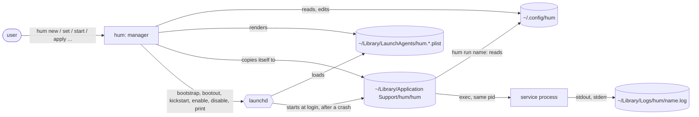
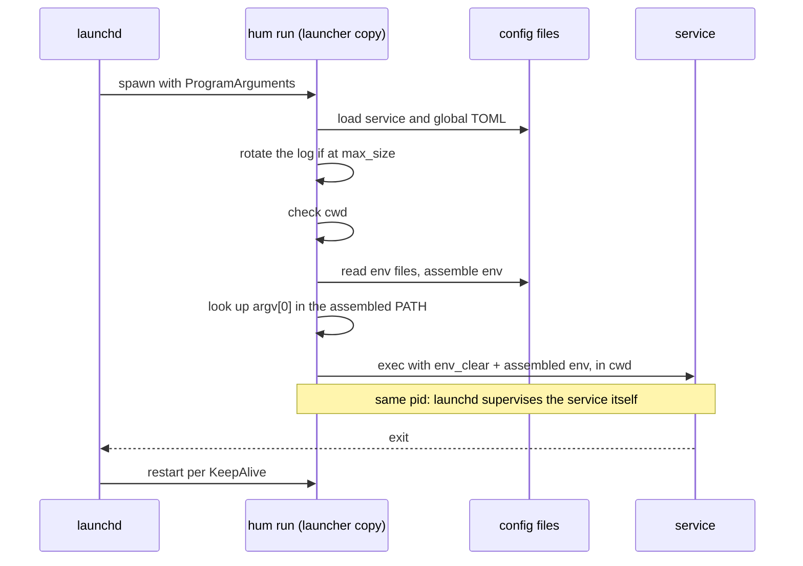

# Architecture

How hum is built: the modules, the files it owns, and the paths each command takes through them. What hum promises its users is in `docs/specs/`; the cross-feature choices behind this shape, with the alternatives turned down, are in `docs/decisions/`.

## Shape

hum is one binary with two roles:

- **Manager**: the other commands read the config directory, render plists, and drive launchd through `launchctl`. Each invocation does its work and exits. Some never touch launchd: `logs`, `edit --global`, `new --no-start`, `completion`.
- **Launcher**: `hum run <name>` is the program every service's plist names. launchd starts it; it assembles the service's environment from the config and `exec`s the service in its own process.

There is no daemon and no state of hum's own. Everything hum knows at any moment it reads from disk and the system: the TOML files and the env files they name, the plists in `~/Library/LaunchAgents` and the launcher copy they run, the logs, and what `launchctl` and the kernel report.



## Modules

The dependency direction runs downward: `cli` depends on `app`, and `app` on the modules below it. Of those, `environ` depends on `config` and `dotenv`; the others depend on nothing inside hum outside their tests.

| Module | Owns | Depends on |
|---|---|---|
| `main.rs` | Entry point, shell completion hook, the exit-code mapping, and the test that checks `// Requirement:` names against `docs/specs/` | `cli` |
| `cli.rs` | The clap command tree, argument parsing, confirmation prompts, text and `--json` output, and the per-command glue (`new`, `edit`, `set`, `rm`, `ls`, `logs`, `apply`, `run`) | `app`, `config`, `environ`, `logfile`, `tomledit` |
| `app.rs` | Every operation that combines config, plist and launchd: start, stop, restart, remove, config-change handling, `ls` states, `show` reports, the `apply` plan, `doctor` findings, run preparation, and the launcher copy | `config`, `environ`, `launchd`, `logfile`, `plist` |
| `config.rs` | Paths, service names and labels, strict TOML parsing of service and global files, defaults and log-setting resolution, rendering new service files and the global template, the keys `set`/`unset` accept and how their values convert, env-key and size validation, PATH capture, atomic writes | — |
| `environ.rs` | Assembling a service's environment in layers and recording which layer set each key; `look_path` against an assembled PATH | `config`, `dotenv` |
| `dotenv.rs` | The `.env` parser and its forward-only `${VAR}` / `$VAR` expansion | — |
| `plist.rs` | Rendering a `Job` to deterministic XML, and reading `ProgramArguments[0]` back | — |
| `launchd.rs` | The `Manager` trait and its `launchctl` implementation in the `gui/<uid>` domain; parsing `launchctl print` and `print-disabled`; process start times from `proc_pidinfo` | — |
| `logfile.rs` | Copy-and-truncate rotation, retention, deleting a log with its copies, `tail`, and `follow` across truncation | — |
| `tomledit.rs` | Comment-preserving TOML edits behind `hum set` and `hum unset` | — |

`app::App` is built once per invocation by every command except `completion`, `run` included. It holds the `Paths`, a boxed `Manager`, the canonical path of the running binary, and a cached answer to whether the launcher copy matches it. Operations on `App` return what happened (`StartOutcome`, `ChangeOutcome`, `Action`, `Finding`, `Report`); printing is left to `cli`.

## Files hum owns

| Path | Written by | Read by |
|---|---|---|
| `~/.config/hum/services/<name>.toml` | `hum new`, `edit`, `set`, `unset`; the user | every command; `hum run` at each start |
| `~/.config/hum/config.toml` | `hum edit --global`; the user. Optional | every command that assembles an environment or log settings |
| `~/Library/LaunchAgents/hum.<name>.plist` | `app` only, through `write_plist`; deleted by `rm` and by `apply` when its config is gone | launchd; `app` when comparing with what it would render; `doctor` reads back the program it runs |
| `~/Library/LaunchAgents/hum._rotate.plist` | `app`, while any service config exists | launchd |
| `~/Library/Application Support/hum/hum` | `app::write_launcher`; deleted with the rotate job | launchd, as `ProgramArguments[0]` of every plist; `app` when comparing it with the running hum |
| `~/Library/Logs/hum/<name>.log` and `<name>__<stamp>[_N].log` | launchd appends; `logfile` rotates and deletes | `hum logs` |
| `~/Library/Logs/hum/_rotate.log` | launchd, for the rotate job; deleted with it | the user |

The service file is the source of truth. A plist is derived from it and the running hum, and is never edited in place: it is rendered whole and compared byte for byte. The label of every hum job is `hum.<name>`; `_rotate` cannot clash with a service because service names cannot start with `_`.

## Generated plists

`App::render_plist` builds a `plist::Job` from a service:

- `Label`: `hum.<name>`.
- `ProgramArguments`: the launcher copy, `run`, the service name.
- `RunAtLoad`: always true. Whether a service comes back at login is carried by launchd's enable/disable record, not by the plist.
- `KeepAlive`: `true` for `restart = "always"`, `{SuccessfulExit = false}` for `on-failure`, absent for `never`.
- `StandardOutPath` and `StandardErrorPath`: the same log file.

Nothing else from the config enters the plist. The command, working directory, env files and environment are read by `hum run` at each start, which is why a change to them needs only a restart and the plist stays the same.

The rotate job's plist runs the launcher copy with `logs --rotate --all --if-oversize` every 30 seconds (`StartInterval`), with `RunAtLoad` false and its output in `_rotate.log`.

Because rendering is deterministic, "is this plist current" is a byte comparison with what this hum would render. Golden files in `testdata/` pin the XML `plist::render` produces for representative jobs.

## The launcher copy

Every plist runs `~/Library/Application Support/hum/hum`, a byte copy of whichever hum binary wrote it, rather than the Homebrew path.

macOS ties privacy grants such as Files and Folders to the path and code signature of the program launchd starts. Homebrew installs each version under a versioned Cellar path, so a plist pointing into the Cellar would carry a new path after every upgrade and lose its grants. The copy keeps one path; a release signed with the same Developer ID keeps the same signature requirement across versions, so its grants carry over.

- `write_launcher` replaces the copy through a temporary file in the same directory and a rename, so the path never points at a partial file and a process that has the old copy open, such as a `hum run` before its `exec`, is unaffected. It is called before any plist is written.
- `launcher_is_current` compares sizes, then bytes, with the running binary, and caches the answer for the invocation.
- `definition_reason` reports "launcher copy is not this hum" after a `brew upgrade`, so `hum ls`, `show`, `doctor` and `apply` all see the upgrade. `hum apply` then refreshes the copy without restarting anything; each job runs the new copy at its next start.
- The copy, the rotate plist and `_rotate.log` are deleted when the rotate job is removed: by `rm` once `services/` holds no file, or by `apply` when no service config is left.

## Environment assembly

`hum run` does not inherit the caller's environment. `environ::assemble` builds it from scratch, each layer overriding the one before:

1. **Base**: `HOME`, `USER`, `SHELL`, `TMPDIR` from the calling process (launchd provides them).
2. **Global `[env]`** from `config.toml`.
3. **Env files** listed in the service's `env_file`, in order. Each `.env` file can expand `${VAR}` and `$VAR` from the earlier layers and from its own earlier lines.
4. **Service `[env]`**.

Each key records the layer that set it, which `hum show` prints. A missing, unreadable or malformed env file is an error that stops `hum run`; `assemble` still returns the layers built so far, which `hum show` displays. An undefined reference expands to an empty string and is a warning.

PATH is not special in assembly; it is whatever the layers set. Since the base layer carries no PATH, `hum new` records the creating shell's PATH into the new service's `[env]` unless `--env PATH=…` was given, resolving per-shell entries (fnm's `fnm_multishells`) to the directories they point at and keeping entries that do not resolve as they are. Program lookup, in `hum run`, in `new`'s warning and in `doctor`'s findings for argv commands, uses `environ::look_path` against the assembled PATH, never hum's own.

## Flows

### `hum run <name>`



`App::prepare_run` loads the configs, rotates the log if it is oversized, and calls `resolve_run`, which checks the working directory, assembles the environment, and resolves the program. The CLI then replaces the process with `exec`, so launchd's pid, exit status and `KeepAlive` all apply to the service and not to a wrapper. A failure before `exec` exits non-zero, and launchd treats it like any crash; a failed log rotation is only a warning. A command written as a string runs through `/bin/sh -c`.

Run by hand, `hum run` takes the same path, so a foreground run and a launchd run see the same environment, provided the caller's `HOME`, `USER`, `SHELL` and `TMPDIR` match launchd's.

### Start, stop, restart, remove

Every write of a plist whose job may be loaded goes through `App::install`; `restart` and `apply_config_change` write directly only once the job is known to be unloaded. launchd keeps the definition it loaded and does not re-read the file, so `install` writes the plist and, if the job is loaded and the plist changed or was loaded from another path, boots it out and back in, kickstarting it if it was running. This keeps "the definition launchd holds is the plist on disk" true.

| Operation | launchd calls | Files |
|---|---|---|
| `start` | nothing if running; else `install`, `enable` if disabled, `bootstrap` if not loaded, `kickstart` | launcher copy, plist, rotate job |
| `stop` | `bootout`, `disable` | none: plist and config stay |
| `restart` | `bootout`; `enable` if disabled; `bootstrap`; `kickstart` | launcher copy, plist, rotate job |
| `rm` | `bootout`; `enable` if disabled; after the last service, `bootout` of the rotate job | plist; config, log and its rotated copies unless `--keep-config`; rotate job and launcher copy once `services/` is empty |

`stop` uses `disable` so the job is not loaded at the next login even though its plist stays in `LaunchAgents`. `enable` is only called for a label that is disabled, because launchd keeps every enable or disable as a record that only root can delete. `bootout` waits until launchd reports the job gone, since a `bootstrap` right after an unfinished `bootout` fails.

### Config edits

`hum set`, `unset` and `edit` change the TOML text and validate the result with the strict parser before writing. `set` and `unset` go through `tomledit`, with the accepted keys and value conversion in `config`; `edit` opens a temporary copy in `$VISUAL` or `$EDITOR` and offers to edit again when the result is invalid. Unchanged text writes nothing. A changed service file is written atomically, then `App::apply_config_change` makes it take effect (`edit --global` only prints what to do next):

- A running service is restarted, unless `--no-restart`.
- A loaded job that is not running keeps its plist, because reloading it would start it under `RunAtLoad`. Only a change to the rendered plist (the `restart` policy) waits and is reported; anything else `hum run` reads at the next start.
- A job that is not loaded gets an existing plist rewritten.

### Out-of-sync detection

`App::sync_reason` is the one answer to "does what runs match the config", used by `ls`, `show` and `doctor`; `apply` uses its first three checks (`plist_reason`). It returns the first of:

1. The plist is missing, or differs from what this hum would render.
2. The launcher copy is not the running hum.
3. launchd loaded the job from a different path.
4. The running process started before the service file, the global file, or one of its env files last changed (a repointed link on a file's path counts), or before a symbolic link on the working directory's path was repointed. The start time comes from the kernel, not from launchd; without one, this check does not fire.

The first three are about the definition and are what `apply` acts on. The fourth only a restart fixes.

### `hum apply`

`App::plan` walks the service files and the `hum.*.plist` files and produces a list of `Action { kind, subject, reason }`:

- **register**: a valid config without a plist.
- **update**: a plist whose definition differs, by the first three reasons above.
- **unregister**: a plist without a config.
- The rotate job: registered while any file exists in `services/` and the job is not installed or not loaded, updated when its definition differs, unregistered when no file is left.

Invalid configs and file names are skipped and reported, and make a non-dry-run `apply` exit 1 even when every action succeeds. An update writes the plist through `install` but loads no job that was not loaded. `--dry-run` prints the plan; otherwise each action goes through `apply_action` in order, stopping at the first failure. A service that `hum stop` disabled keeps only its plist on register, so it stays stopped.

### Log rotation

launchd opens each log with `O_APPEND` when it starts the job and the service keeps writing through that descriptor, so logs rotate by copy and truncate: `logfile::rotate` copies the log to `<name>__<YYYY-MM-DD_HH-MM-SS>.log` (with `_N` added on a clash within one second), truncates the original in place, and deletes copies beyond `keep`. It runs in three places:

- `hum run`, before each start, when the log has reached `max_size`.
- The rotate job, every 30 seconds, over all services, for those at or over `max_size`.
- `hum logs --rotate`, on demand.

`logfile::follow` notices truncation and reads from the start of the file again.

## launchd boundary

`launchd::Manager` is the only way `app` reaches launchd:

```rust
pub trait Manager {
    fn status(&self, label: &str) -> Result<Status>;
    fn disabled(&self) -> Result<HashSet<String>>;
    fn bootstrap(&self, plist: &Path) -> Result<()>;
    fn bootout(&self, label: &str) -> Result<()>;
    fn enable(&self, label: &str) -> Result<()>;
    fn disable(&self, label: &str) -> Result<()>;
    fn kickstart(&self, label: &str) -> Result<()>;
}
```

`Launchctl` implements it by running `launchctl` in `gui/<uid>` and parsing the text of `launchctl print` (top-level fields only) and `print-disabled` (both the `disabled` and older `true` spellings). `Status` carries whether the job is loaded and running, its pid, the plist path launchd loaded, the last exit code and signal, and the process start time.

Off macOS, `launchd::new` returns a manager whose every call fails, so the crate builds and its tests run on any Unix.

## Testing

- **Unit tests** in each module. `app` tests use `FakeLd`, an in-memory `Manager` that records the calls that change launchd state, over a temporary home directory with a fake hum binary, so operations, plans and findings are checked without launchd.
- **Golden files** in `testdata/` pin the plist output; `UPDATE_GOLDEN=1 cargo test` regenerates them.
- **`tests/cli.rs`** runs the built binary for the commands and paths that do not need launchd.
- **Real launchd**: `cargo test -- --ignored --test-threads=1 launchd::macos` drives the `Launchctl` implementation against the user's own launchd, with `local.hum-test.<pid>.<n>` labels and plists in a temporary directory.
- **Spec links**: tests name the requirements they cover with `// Requirement: <name>`, and a test in `main.rs` fails when a name in `src/` is not in `docs/specs/`; names in `tests/` are not checked.

## Build and release

`dist` (cargo-dist) builds release binaries for arm64 and x64 macOS from `.github/workflows/release.yml` when a version tag is pushed; on pull requests the workflow only plans. It signs them with the certificate in the repository's `CODESIGN_CERTIFICATE`, `CODESIGN_CERTIFICATE_PASSWORD` and `CODESIGN_IDENTITY` secrets and publishes a formula to the `plimeor/homebrew-tap` repository with `HOMEBREW_TAP_TOKEN`, so users install with `brew install plimeor/tap/hum`. `publish-prereleases` is on, so release candidates reach the tap too. Settings are in `dist-workspace.toml`; the workflow carries hand edits (the tap commit author), which is why `allow-dirty = ["ci"]` is set.
